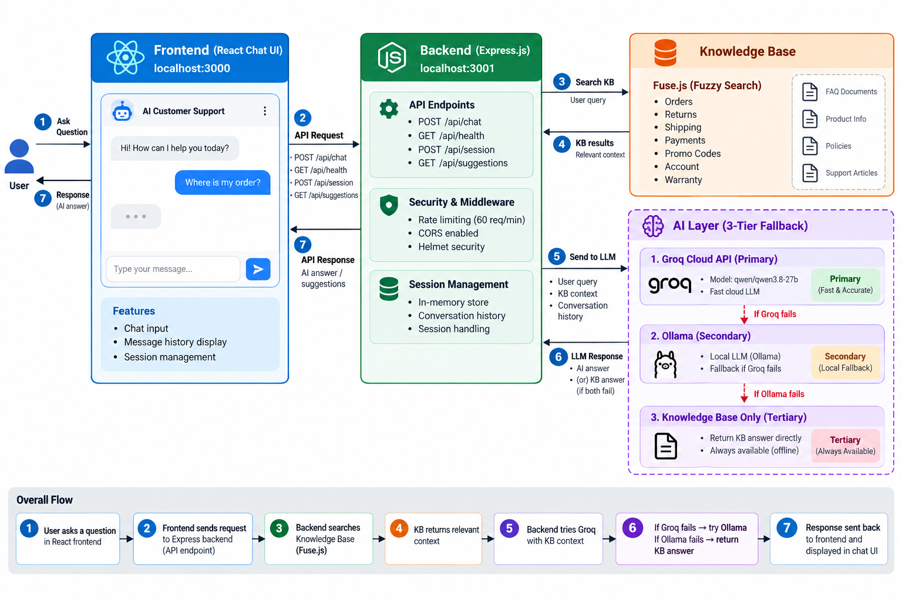

# 🤖 AI Customer Support Agent

A full-stack AI-powered customer support chatbot that answers questions naturally using a live LLM, backed by a structured knowledge base and an offline fallback — no paid cloud infrastructure required.



---

## Tech Stack

| Layer | Technology |
|-------|-----------|
| Frontend | React 19 + Vite |
| HTTP Client | Axios |
| Markdown Rendering | react-markdown + remark-gfm |
| Backend | Node.js + Express |
| Fuzzy Search | Fuse.js |
| Primary AI | Groq API (llama / compound-mini) |
| Secondary AI | Ollama (local LLM, optional) |
| Security | Helmet, express-rate-limit, CORS |
| Session Management | In-memory with UUID |

---

## How It Works

### AI Priority Chain

```
User Message
     │
     ▼
1. Groq API  ──► Fast LLM response (groq/compound-mini)
     │ (fails or not configured?)
     ▼
2. Ollama    ──► Local LLM (llama3, if running)
     │ (not available?)
     ▼
3. Knowledge Base ──► Direct FAQ match (offline fallback)
```

### Smart Message Routing

The engine detects **conversational messages** (greetings, thanks, casual chat) via pattern matching and routes them directly to the LLM — skipping the knowledge base entirely.

- `"hi"` → LLM responds warmly: *"Hello! 👋 How can I help you today?"*
- `"where is my order?"` → LLM answers using KB entries as grounded context

For support questions, the KB is fuzzy-searched first and injected as context into the LLM prompt, so responses stay accurate and policy-grounded.

### Knowledge Base

20+ FAQ entries covering:

- Orders (tracking, cancellation, modifications)
- Returns & Refunds
- Shipping (times, costs, international)
- Payment (methods, promo codes, invoices)
- Account (password reset, sign up, deletion)
- Products (warranty, stock availability)
- Technical Support
- General (contact hours, loyalty program)

---

## API Endpoints

| Method | Endpoint | Description |
|--------|----------|-------------|
| GET | `/api/health` | Server status + active AI mode |
| POST | `/api/session` | Create a new chat session |
| POST | `/api/chat` | Send a message, receive AI response |
| GET | `/api/suggestions` | Suggested questions + categories |
| GET | `/api/session/:id/history` | Fetch conversation history |
| DELETE | `/api/session/:id` | Clear a session |

---

## UI Features

- Real-time chat with smooth message animations
- Typing indicator (bouncing dots while AI responds)
- Markdown rendering — bold, bullets, numbered lists
- Suggestion chips — 8 clickable common questions
- Source badge on every message:
  - ⚡ Groq AI — answered by LLM
  - 📚 KB — answered from knowledge base
  - 💬 — system/fallback
- Animated background — gradient orbs + floating particles
- Glassmorphism UI — frosted-glass chat panel
- Light/dark theme — auto-detects system preference
- Fully responsive — works on mobile and desktop

---

## Getting Started

**1. Install dependencies**

```bash
cd backend && npm install
cd ../frontend && npm install
```

**2. Configure your Groq API key**

Create `backend/.env`:

```env
GROQ_API_KEY=your_key_here   # free at https://console.groq.com
GROQ_MODEL=groq/compound-mini
```

**3. Start both servers**

Terminal 1 (backend):
```bash
cd backend && npm start
```

Terminal 2 (frontend):
```bash
cd frontend && npm run dev
```

**4. Open** → http://localhost:3000

> Groq offers a free tier. If you skip the API key, the agent falls back to the local knowledge base automatically.

---

## Project Structure

```
ai-support-agent/
├── backend/
│   ├── src/
│   │   ├── server.js          # Express API server
│   │   └── ai-engine.js       # Groq + Ollama + KB logic
│   ├── data/
│   │   └── knowledge-base.js  # 20+ FAQ entries
│   └── .env                   # API keys (not committed)
├── frontend/
│   ├── src/
│   │   ├── App.jsx            # Chat UI component
│   │   ├── App.css            # Chat styles + animations
│   │   └── index.css          # Theme variables + background
│   └── vite.config.js         # Dev server + API proxy
├── screenshot.png
└── README.md
```

---

## License

MIT
